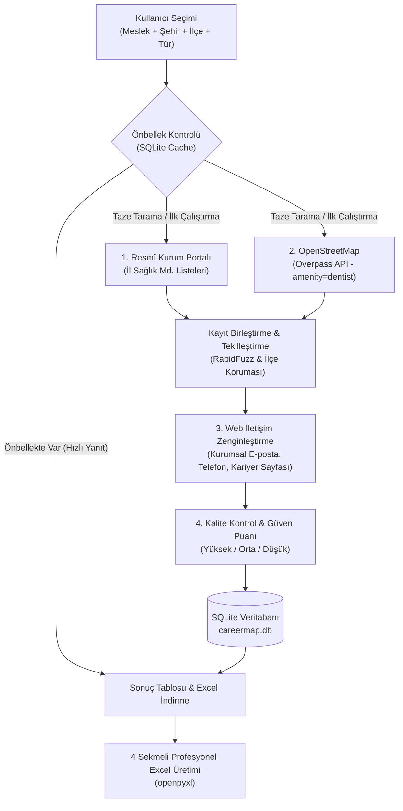

# CareerMap — Konum Bazlı Potansiyel İşveren Keşif Platformu

> **"Bölgenizdeki işverenleri açık verilerle keşfedin, doğrudan kurumsal iletişim kanallarına ulaşın."**

---

## 🎯 Proje Vizyonu ve Temel Yaklaşım

CareerMap, yalnızca tek bir sektöre sıkışıp kalmayan; **"Meslek → Hedef İşveren Türleri → Açık Veri Kaynakları"** mimarisi üzerine kurulu genel amaçlı bir potansiyel işveren bulma platformudur.

Platformun ilk canlı pilotu **"Diş Hekimi + Eskişehir"** olarak hayata geçirilmiştir. Ancak yazılım mimarisi en baştan itibaren yazılım geliştirici, endüstri mühendisi, mimar, avukat veya veteriner hekim gibi farklı mesleklere kolayca uyarlanabilecek nesne yönelimli bir eklenti (registry) yapısıyla tasarlanmıştır.

### 💡 0 Ücretli Kaynak İlkesi (Tamamen Ücretsiz Mimari)
- ❌ **Ücretli Google Places / Maps API yok**
- ❌ **Ücretli LLM / Yapay Zekâ API maliyeti yok**
- ❌ **Ücretli bulut veritabanı maliyeti yok**
- ✅ **OpenStreetMap (Overpass API) ile açık işletme keşfi (ODbL uyumlu)**
- ✅ **Resmî Kurum Açık Verileri (İl Sağlık Müdürlüğü kayıtları)**
- ✅ **İşletmelerin açık web sitelerinden saygılı iletişim analizi (robots.txt & rate-limiting)**
- ✅ **SQLite Yerel Önbellek (Her aramada harici servislere yük bindirmeyen akıllı cache)**
- ✅ **RapidFuzz ile yüksek doğruluklu algoritmik tekilleştirme (Deduplication)**

---

## 🏗️ 4 Katmanlı Sistem Mimarisi



---

## 📊 4 Sekmeli Excel Rapor Yapısı

CareerMap, ham ve karmaşık bir veri yığını yerine iş arayanların doğrudan eyleme geçebileceği **4 ayrı sekme** üretir:

1. **Tüm İşverenler:** Tekilleştirilmiş ana liste, açık adresler, kurum türleri, telefonlar, web siteleri ve kaynak bağlantıları.
2. **E-posta Bulunanlar:** Doğrudan CV ve ön yazı göndermek için kullanılabilecek doğrulanmış kurumsal e-posta adresleri.
3. **Eksik ve Kontrol Listesi:** Web sitesi veya e-postası bulunamayan, telefonla arama veya yerel ziyaret gerektiren kayıtlar.
4. **Kaynaklar ve Tarama Raporu:** Hangi kaynaklardan kaç kayıt geldiği, e-posta başarı oranı, son güncelleme zamanı ve ODbL / kullanım uyarıları.

---

## 📂 Dosya ve Dizin Mimarisi

```
careermap/
├── app/
│   ├── main.py                     # FastAPI ana uygulaması ve sayfa yönlendiricileri
│   ├── database/
│   │   ├── db.py                   # SQLite bağlantısı, önbellekleme ve sorgular
│   │   └── models.py               # Pydantic modelleri ve şemalar
│   ├── professions/                # Meslek soyutlama modülü (Genişletilebilir yapı)
│   │   ├── base.py                 # BaseProfession soyut sınıfı
│   │   ├── registry.py             # Merkezi ProfessionRegistry
│   │   ├── dentist.py              # Diş Hekimi pilot kuralları & resmi veri kaynağı
│   │   ├── software_engineer.py    # Yazılım Geliştirici (Teknoparklar & Bilişim firmaları)
│   │   └── industrial_engineer.py  # Endüstri Mühendisi (OSB & Üretim tesisleri)
│   ├── discovery/                  # İşletme keşif motorları
│   │   ├── official_source.py      # İl Sağlık Müdürlüğü HTML tablo okuyucusu
│   │   └── osm_source.py           # OpenStreetMap Overpass API sorgulayıcısı
│   ├── enrichment/                 # İletişim zenginleştirme motorları
│   │   ├── email_extractor.py      # Web sitelerinden e-posta ve kariyer sayfası çıkarma
│   │   ├── phone_extractor.py      # Telefon numarası formatlama
│   │   └── website_finder.py       # Tescilli klinik domain rehberi ve eşleştirme
│   ├── matching/                   # Birleştirme ve kalite kontrol
│   │   ├── deduplicator.py         # RapidFuzz tabanlı tekilleştirme motoru
│   │   └── confidence.py           # 0-100 güven ve doğrulama puanlayıcısı
│   ├── exports/
│   │   └── excel_exporter.py       # openpyxl ile 4 sekmeli şık Excel üretimi
│   └── routes/
│       ├── search.py               # /api/search, /api/scan, /api/professions uç noktaları
│       └── export.py               # /export/excel canlı indirme uç noktası
├── templates/
│   ├── base.html                   # Bootstrap 5 tabanlı modern ana şablon
│   ├── index.html                  # Arama ve keşif yapılandırma arayüzü
│   └── results.html                # Dinamik tablo, filtreler ve istatistik sayfası
├── static/
│   ├── css/style.css               # Özel stiller, renk paleti ve kart efektleri
│   └── js/app.js                   # İstemci tarafı scriptleri
├── run.py                          # Web sunucusu & CLI çalıştırma scripti
└── requirements.txt                # Python bağımlılıkları
```

---

## 🚀 Kurulum ve Çalıştırma

### 1. Bağımlılıkları Yükleyin
```bash
pip install -r careermap/requirements.txt
```

### 2. Web Arayüzünü Başlatın
```bash
python careermap/run.py
```
Tarayıcınızda açın: **[http://127.0.0.1:8000](http://127.0.0.1:8000)**

### 3. Alternatif: Terminalden (CLI) Doğrudan Excel Üretin
Web sunucusu açmadan, doğrudan komut satırından tara ve Excel üret:
```bash
python careermap/run.py --cli --output Eskisehir_Dis_Hekimleri.xlsx
```
Önbelleği sıfırlayıp taze tarama yapmak için:
```bash
python careermap/run.py --cli --refresh --output Eskisehir_Dis_Hekimleri.xlsx
```

---

## 🧩 Yeni Bir Meslek Nasıl Eklenir?

Yeni bir meslek eklemek için tek yapmanız gereken `app/professions/base.py` sınıfından türeyen yeni bir dosya oluşturmak:

```python
# app/professions/lawyer.py
from .base import BaseProfession

class LawyerProfession(BaseProfession):
    id = "lawyer"
    name = "Avukat"
    description = "Hukuk büroları, avukatlık ortaklıkları ve danışmanlık firmaları"
    icon = "bi-bank"
    
    supported_cities = {
        "Eskişehir": ["Tepebaşı", "Odunpazarı"]
    }
    
    employer_types = [
        {"id": "all", "label": "Tüm Hukuk Büroları"},
        {"id": "office", "label": "Bireysel Avukatlık Büroları"},
        {"id": "partnership", "label": "Avukatlık Ortaklıkları"}
    ]
    
    osm_tags = [
        {"key": "office", "value": "lawyer"}
    ]

    def get_official_sources(self, city: str):
        return [{"type": "baro", "label": "Eskişehir Barosu Levhası", "url": "..."}]
        
    def parse_official_records(self, soup_dict, city):
        # Baro tablosunu parse et
        return [...]
```

Ardından `app/professions/registry.py` içine kaydedin:
```python
ProfessionRegistry.register(LawyerProfession())
```
Sistemdeki tüm arama arayüzü, filtreler ve Excel dışa aktarıcı **otomatik olarak** yeni mesleği destekleyecektir!

